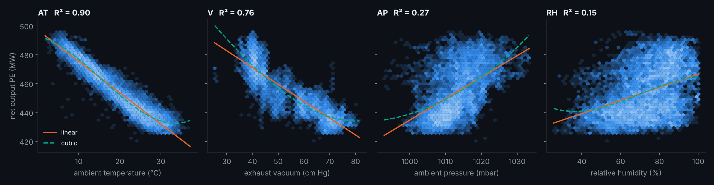
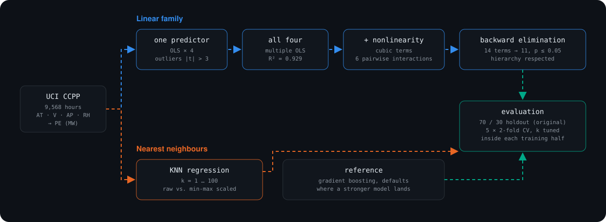
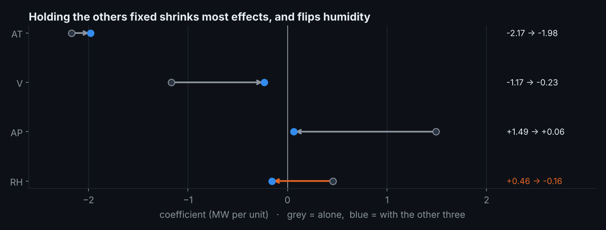
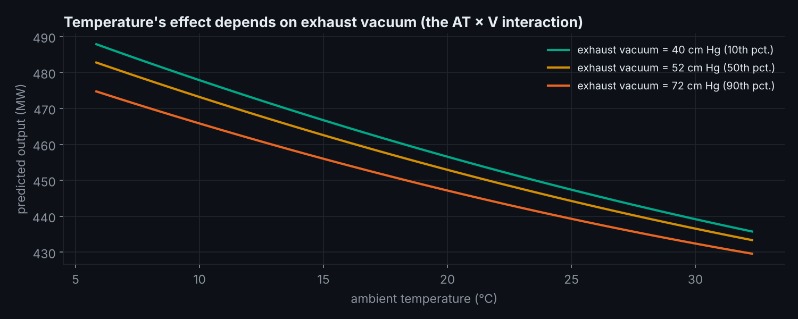
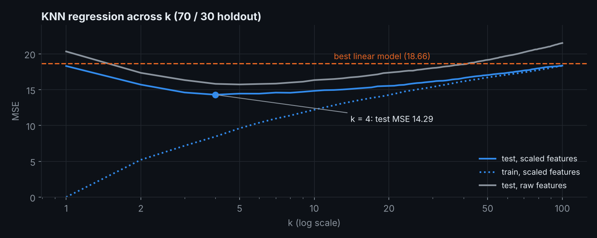
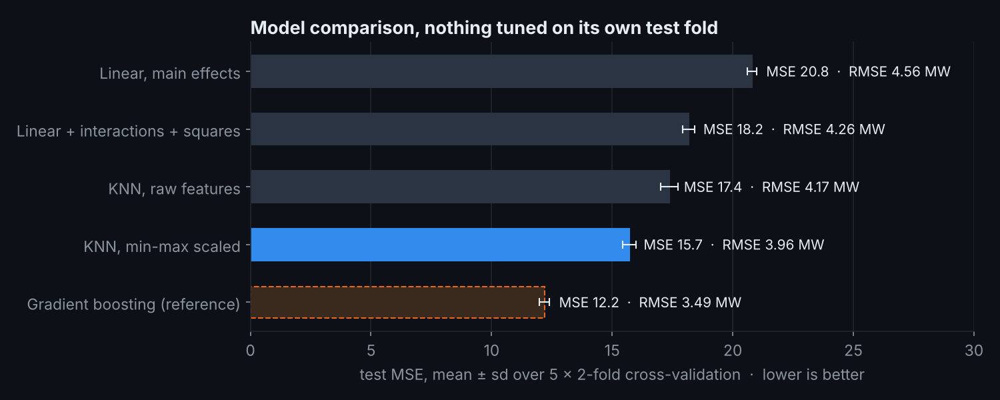

<p align="center">
  
</p>

<p align="center">
  
  
  
  
  
</p>

<p align="center">
  <a href="#the-problem">Problem</a> ·
  <a href="#approach">Approach</a> ·
  <a href="#what-the-linear-models-say">Linear models</a> ·
  <a href="#knn-vs-linear">KNN vs. linear</a> ·
  <a href="#quickstart">Quickstart</a> ·
  <a href="#repository-structure">Structure</a> ·
  <a href="#limitations">Limitations</a>
</p>

# plant-power

> Predicting a combined-cycle power plant's hourly electrical output from four weather readings. A progression of linear models (one predictor, multiple regression, interactions, backward elimination) is compared against KNN regression, then checked with 5 × 2-fold cross-validation.

Temperature alone explains **90%** of the variance in output. The best interpretable model, linear with interactions and squared terms, reaches an RMSE of **4.3 MW**. KNN on scaled features beats it in **all 10 cross-validation folds**, at **4.0 MW**. Along the way, humidity's coefficient flips sign, which is a clean real-world case of confounding.

---

## The problem

A combined-cycle plant burns gas in a turbine, then recovers the exhaust heat to drive a steam turbine. Its output at full load depends on the air it breathes: hot, thin air means less mass through the turbine and less power. Predicting output from the weather matters for grid scheduling, since a plant that over-promises its capacity pays penalties.

| Variable | Meaning | Range |
|---|---|---|
| **AT** | ambient temperature | 1.8 to 37.1 °C |
| **V** | exhaust vacuum | 25.4 to 81.6 cm Hg |
| **AP** | ambient pressure | 992.9 to 1033.3 mbar |
| **RH** | relative humidity | 25.6 to 100.2 % |
| **PE** (target) | net hourly electrical output | 420.3 to 495.8 MW |

9,568 hourly averages from 2006 to 2011, from the [UCI Machine Learning Repository](https://archive.ics.uci.edu/dataset/294/combined+cycle+power+plant) (CC BY 4.0, Tüfekci 2014).

<p align="center">
  
</p>

## Approach

<p align="center">
  
</p>

The linear models are built up one step at a time, so each step's gain is visible. KNN is the flexible, assumption-free alternative. Everything is first evaluated on a 70/30 holdout, then on **5 × 2-fold cross-validation**: the protocol the dataset was published for, where KNN's k is tuned inside each training half so the score is never on data used for tuning.

## What the linear models say

### One predictor at a time

| Predictor | Slope (MW per unit) | R² | Outliers (\|t\| > 3) | R² without them |
|---|---|---|---|---|
| AT | −2.17 | **0.899** | 42 | 0.906 |
| V | −1.17 | 0.757 | 33 | 0.767 |
| AP | +1.49 | 0.269 | 29 | 0.286 |
| RH | +0.46 | 0.152 | 2 | 0.153 |

Every degree Celsius costs about 2.2 MW. Removing the studentized-residual outliers moves no slope by more than 1%, and the flagged hours are real readings in the tails rather than errors, so they stay in.

### All four together, and the humidity flip

<p align="center">
  
</p>

The multiple regression explains **92.9%** of the variance. Most coefficients shrink once the others are held fixed, because the predictors overlap: temperature correlates with vacuum at 0.84 and with pressure at −0.51.

**Humidity flips sign**, from +0.46 alone to −0.16. Humid hours tend to be cool hours (correlation −0.54), and cool air raises output, so humidity *looks* helpful on its own. With temperature held fixed, more humidity slightly lowers output (−0.21 MW per % with temperature alone as a control). Reading the one-predictor slope as a causal effect would get the direction wrong.

### Nonlinearity and interactions

- **Cubic terms:** only temperature's curvature matters in practice (R² 0.899 → 0.912). Pressure and humidity have "significant" higher-order terms, but they add under 0.01 R². With 9,568 points, tiny effects clear p < 0.05 easily.
- **Interactions:** 4 of 6 pairs are significant, led by **AT × V** (p ≈ 10⁻¹¹⁷). Temperature's effect depends on vacuum, which makes physical sense: both describe how well the turbines reject heat.

<p align="center">
  
</p>

### Backward elimination

Starting from all 4 main effects, 6 interactions and 4 squares (14 terms), the least significant term is dropped until every p ≤ 0.05. A main effect is never dropped while an interaction or power of it remains. Three terms go (V × RH, V², V × AP), leaving 11.

| Model (70/30 holdout) | Train MSE | Test MSE |
|---|---|---|
| Main effects only | 20.58 | 21.24 |
| **Interactions + squares, reduced** | 17.89 | **18.66** |

That's a 12% lower test error, with almost no train/test gap.

## KNN vs. linear

<p align="center">
  
</p>

KNN on min-max scaled features reaches its best holdout error at **k = 4 (test MSE 14.29)**, 23% below the best linear model. **Scaling matters:** on raw features, pressure (values around 1,013) dwarfs everything else in the distance, and the best error is 15.73.

That holdout number picks k on the test set, so it's optimistic. The cross-validated comparison removes that:

<p align="center">
  
</p>

| Model, 5 × 2-fold CV | Test MSE | RMSE |
|---|---|---|
| Linear, main effects | 20.78 ± 0.19 | 4.56 MW |
| Linear + interactions + squares | 18.18 ± 0.26 | 4.26 MW |
| KNN, raw features | 17.37 ± 0.35 | 4.17 MW |
| **KNN, min-max scaled** (k chosen per fold: 4 to 9) | **15.70 ± 0.27** | **3.96 MW** |
| *Gradient boosting, default settings (reference)* | *12.20 ± 0.21* | *3.49 MW* |

- **The ranking is rock-solid.** Scaled KNN beats the best linear model in **10 of 10 folds**, and every fold-to-fold spread is under 0.4.
- **Honest KNN error is 15.7, not 14.3.** Tuning k on the test set had flattered it by about 9%. (Each 5 × 2 fold also trains on only half the data, which accounts for part of the gap.)
- **The gradient-boosting reference** shows how much headroom remains: a tree ensemble with no tuning beats every model here by another 22%. It's a reference point, not part of the original analysis.

**The trade-off:** the linear model tells you *how much* each degree of temperature costs and lets you check its assumptions. KNN predicts better but explains nothing. For a dispatch forecast you'd use the predictor; for understanding the plant you'd use the regression.

## Quickstart

```bash
git clone https://github.com/AtharvaThorat/power-plant-energy-regression-linear-vs-knn.git
cd power-plant-energy-regression-linear-vs-knn
pip install -r requirements.txt

python scripts/run_all.py          # every model → results/results.json  (about 1 minute)
python scripts/run_all.py --quick  # skip the 5 × 2 cross-validation (a few seconds)
python scripts/make_figures.py     # rebuild every figure in assets/
pytest -q                          # 6 tests that pin the headline numbers
```

The dataset (2 MB) is included in `data/`.

**Use the pieces directly:**

```python
from ccpp import load, split, backward_eliminate, fit_ols, knn_sweep, mse

train, test = split(load())
formula, removed = backward_eliminate(train)       # hierarchy-respecting elimination
model = fit_ols(formula, train)
print(mse(test.PE, model.predict(test)))           # 18.66

curve = knn_sweep(train, test, ks=range(1, 21))    # scaled KNN, train/test MSE per k
print(curve.loc[curve.test_mse.idxmin()])          # k = 4
```

The full analysis, with every table and diagnostic plot, is in [`notebooks/power_plant_regression.ipynb`](notebooks/power_plant_regression.ipynb).

## Repository structure

```
power-plant-energy-regression-linear-vs-knn/
├── ccpp/
│   ├── data.py          # loading and the 70/30 split
│   └── models.py        # OLS helpers, backward elimination, KNN sweep, 5 × 2 CV
├── scripts/
│   ├── run_all.py       # every experiment → results/results.json
│   └── make_figures.py  # README figures
├── tests/
│   └── test_results.py  # pins R², the sign flip, the eliminated terms, KNN's k and MSE, the CV ranking
├── notebooks/
│   └── power_plant_regression.ipynb
├── data/Folds5x2_pp.xlsx
├── results/results.json
└── assets/              # banner, pipeline, figures
```

## Limitations

- **No time structure.** The rows are hourly readings with timestamps removed and order shuffled, so random splits ignore seasonality and autocorrelation. A real forecasting setup would train on earlier years and test on later ones.
- **p-value model selection.** Backward elimination at α = 0.05 is easy to explain but unstable: with this much data almost every term is "significant", and the chosen terms could change across resamples.
- **Full-load data only.** The plant was at full load throughout, so the models say nothing about part-load operation.
- **KNN scales poorly.** Prediction cost grows with the training set, which is fine at 10k rows but not at plant-fleet scale.

## Tech stack

`Python` · `statsmodels` · `scikit-learn` · `pandas` · `NumPy` · `matplotlib` · `seaborn` · `pytest`

## Acknowledgements

Built while studying machine learning at USC. Data from Pınar Tüfekci and Heysem Kaya via the UCI Machine Learning Repository.

---

<sub>Built by **Atharva Thorat** · [@AtharvaThorat](https://github.com/AtharvaThorat) · MS Computer Science @ USC</sub>
